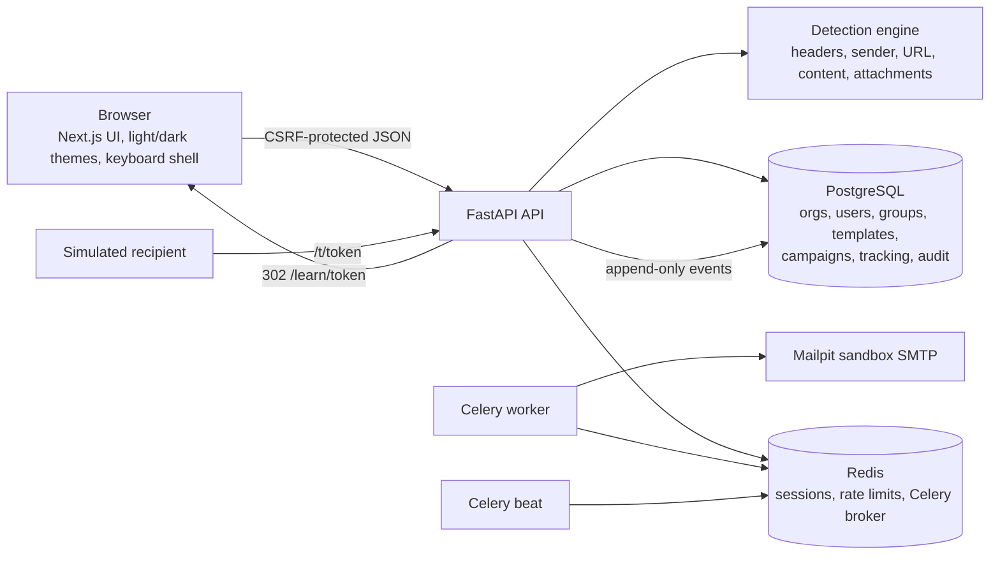

# Phishing Attack Simulator

An authorized, educational phishing-simulation and real-mail detection platform. The simulation half measures behaviour with safe, consented campaigns. The detection half explains why a real email looks risky. Both halves share templates, reporting and training.

> **Authorized and educational use only.** A signed authorization and rules of engagement are required before any campaign can launch. Simulations never capture real passwords, never send malware or real attachments, and never use filter-evasion techniques. Development uses Mailpit; no real mail is sent.

## Quick start: one command

```bash
make demo
```

`make demo` starts the Docker stack, waits for the API and web app, applies the Alembic migration chain, seeds the demo organization, both demo admins, the template library, the demo group, campaigns and tracking events, then prints the URLs and demo login emails.

Passwords come from `.env` (`DEMO_ADMIN_1_PASSWORD`, `DEMO_ADMIN_2_PASSWORD`) and are never printed. If either value is empty, `make demo` generates a strong value into `.env` without echoing it. `.env` is created from `.env.example` when missing and is never committed.

Demo URLs:

| Service | URL |
|---|---|
| Frontend | http://127.0.0.1:3000 |
| API health | http://127.0.0.1:8000/health |
| Mailpit | http://127.0.0.1:8025 |

Demo admin emails:

- `demo-admin-1@example.test`
- `demo-admin-2@example.test`

Seeded data:

- Organization: **Demo Organization** (`demo-org`)
- Group: **Demo Finance Team** (8 sandbox targets on `example.test`)
- Campaigns: **Demo awareness: invoice review** (completed) and **Demo awareness: travel policy update** (running)

## Five-minute demo script

1. **Log in.** Open http://127.0.0.1:3000/login and sign in as `demo-admin-1@example.test` with `DEMO_ADMIN_1_PASSWORD` from `.env`. Use the theme toggle to check light and dark mode.
2. **Create a campaign.** Open **Campaigns → New campaign**, name it, choose a published template, the **Demo Finance Team** group, a send time, `example.test` as the sending domain, then save the draft.
3. **Send a test.** In the **Launch** step, send a labelled test to the Mailpit sandbox inbox. Open http://127.0.0.1:8025 and confirm the `[TEST]` message arrived. No target recipient is contacted.
4. **Approve with two admins.** Request authorization as admin 1. Sign out and sign in as `demo-admin-2@example.test`; open **Campaigns → Approvals waiting for you**, review the exact scope and approve. A requester can never approve their own campaign.
5. **Launch.** Sign back in as admin 1 and choose **Launch campaign → Confirm launch**. The server re-checks the approval, group size, sandbox domain and schedule before queuing delivery.
6. **Open Mailpit and click.** In Mailpit, open the simulated message and follow its link. The link records one click and redirects to the awareness page. Automated preview/bot user agents are ignored.
7. **Awareness page.** Read the blame-free explanation and the red flags taken from the template.
8. **Quiz.** Choose **Start the quiz**, answer the questions and finish. Completion is recorded once and is not a score or ranking.
9. **Report.** Open **Reports**, select the campaign, review the funnel, group table, trend and suppression rules, then export CSV.
10. **Analyzer.** Open **Mail Analyzer**, load the sample or paste a suspicious message, confirm authorization, analyze it, read the 0–100 score and the plain-language reasons, then save the verdict. Message content is not stored in the report.

## Architecture



Components:

- **Frontend:** Next.js App Router, Tailwind design tokens, one content file for UI strings, server-read theme cookie, responsive shell and skip link.
- **Backend:** FastAPI, SQLAlchemy, Alembic, Argon2id password hashing, server-side sessions, CSRF tokens, rate limits, RBAC, append-only audit log.
- **Async:** Celery worker for scheduled delivery and Celery beat for retention work.
- **Mail:** Mailpit only in development and tests; sandbox domains only (`example.com`, `*.test`, `*.invalid`).
- **Detection:** explainable, offline rules with a 0–100 score; no network calls and no live credentials.

## Run and test commands

```bash
make demo        # start stack, migrate, seed, print URLs and demo emails
make up          # start the stack without seeding
make down        # stop the stack
make migrate     # apply Alembic migrations
make seed        # seed dev + demo data
make lint        # ruff + mypy + ESLint + TypeScript
make test        # pytest + Playwright (backend and UI)
make reset       # remove containers and volumes after confirmation
make unlock-user EMAIL=user@example.test
make web-prod    # production-profile web container
```

The full suite is Docker-only. `make test` derives the Compose network at run time, so it also works from a fresh clone in any directory.

Migrations continue one linear chain with exactly one head:

```bash
docker compose exec -T -e PYTHONPATH=/app api alembic heads
# 0009_analyzer_reports (head)
```

## Screenshot checklist

| Page | URL |
|---|---|
| Login | http://127.0.0.1:3000/login |
| Request access / sign-up | http://127.0.0.1:3000/signup |
| Dashboard | http://127.0.0.1:3000/ |
| Campaigns | http://127.0.0.1:3000/campaigns |
| Templates | http://127.0.0.1:3000/templates |
| Groups | http://127.0.0.1:3000/groups |
| Reports | http://127.0.0.1:3000/reports |
| Mail Analyzer | http://127.0.0.1:3000/analyzer |
| Settings | http://127.0.0.1:3000/settings |
| Audit log | http://127.0.0.1:3000/settings/audit |
| Awareness page | http://127.0.0.1:3000/learn/<token> |
| Awareness quiz | http://127.0.0.1:3000/learn/<token>/quiz |
| Tracking redirect | http://127.0.0.1:3000/t/<token> |

`<token>` is the unguessable per-target token from a seeded campaign. Open a tracking link from Mailpit, or use the token from the campaign's tracking URL. `/learn/demo-token` renders the fallback awareness content for screenshots without a live token.

Capture both light and dark themes for the main pages. The Playwright suite already checks axe accessibility, keyboard use, 320/768/1440 px layouts and reduced motion.

## Safety rules

- Authorized and educational use only; written authorization and rules of engagement before launch.
- Never capture real passwords. A simulated form records only that it was touched.
- Sandbox sending domains only (`example.com`, `*.test`, `*.invalid`); no real brand domains or logos.
- Mailpit only in development and tests; SMTP relay is reserved for approved pilots on sandbox domains.
- No malware, real attachments or filter-evasion techniques.
- Minimal data with a configurable retention period (default 90 days).
- Group-level reporting by default; groups below the reporting minimum are suppressed.
- Non-punitive, blame-free language; no individual ranking or shaming.
- Audit log for privileged, authorization and campaign actions; the audit table is append-only.
- All user and email content escaped; parameterized queries; hashed passwords; CSRF and rate limits; secrets only in environment variables.

## Security measures

- **CSP:** production keeps a nonce-based `script-src 'nonce-…' 'strict-dynamic'` policy with `object-src 'none'` and `base-uri 'self'`. No inline scripts, no inline style attributes and no `unsafe-inline` in the production policy.
- **CSRF:** session-bound tokens plus Origin/Referer checks on state-changing requests.
- **Rate limits:** account and IP limits on login, analyzer and reporting endpoints, with lockout backoff.
- **Sessions:** HttpOnly, SameSite cookies; server-side hashed session tokens; idle and absolute expiry; rotation on login.
- **Audit log:** append-only database triggers, organization scoping, redacted payloads and CSV export.
- **Headers:** `X-Content-Type-Options`, `X-Frame-Options`, `Referrer-Policy`, request IDs and strict production CSP.
- **RBAC:** admin, analyst and employee roles with least privilege; last-admin protection.

## Known limitations

- No password-reset flow; an administrator must unlock or reset accounts.
- The Settings page is read-only in the UI even though the settings API exists.
- Detection is a transparent rule engine, not a trained ML classifier; it does not fetch live DNS, WHOIS or reputation data.
- Delivery is Mailpit-only; no production SMTP relay is configured.
- No formal SUS usability study has been run yet; accessibility results come from automated axe checks plus manual keyboard, zoom, responsive and reduced-motion checks.
- The demo dataset is synthetic and must not be used to infer real organizational behaviour.

## Documentation

- [`docs/final-report-outline.md`](docs/final-report-outline.md) — final report structure, evaluation summary and limitations
- [`docs/PLAN.md`](docs/PLAN.md) — authoritative scope, safety, HCI, detection and architecture
- [`docs/design-system.md`](docs/design-system.md) — tokens, components, status language and copy rules
- [`docs/requirements.md`](docs/requirements.md) — roles, user stories and MoSCoW scope
- [`docs/ethics-and-consent.md`](docs/ethics-and-consent.md) — authorization, consent, data handling and non-punitive reporting
- [`docs/threat-model.md`](docs/threat-model.md) — assets, abuse cases, ATT&CK and kill chain
- [`docs/architecture.md`](docs/architecture.md) — components, schema and API outline
- [`docs/hci-and-wireframes.md`](docs/hci-and-wireframes.md) — personas, flows, heuristics and page wireframes
- [`docs/evaluation-plan.md`](docs/evaluation-plan.md) — human, detector and SUS evaluation
- [`docs/runbook.md`](docs/runbook.md) — start/stop, migrations, scheduling, retention and troubleshooting

## Repository layout

```text
frontend/     Next.js application, Playwright tests
backend/      FastAPI API, Celery workers, Alembic migrations, pytest suite
ml/           Detection notes and evaluation space
docs/         Plan, design, analysis, runbook and final report outline
scripts/      One-command demo script
legacy/       Unchanged v1 single-file reference app
```

The repository owner handles commits and pushes.
