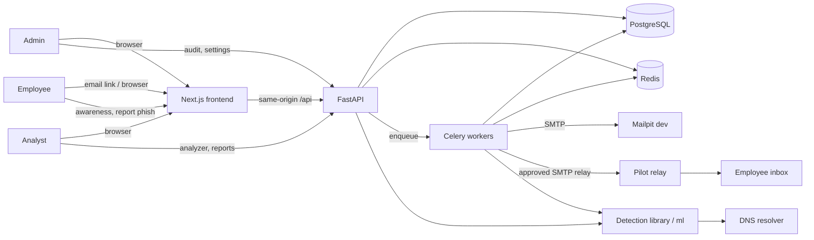
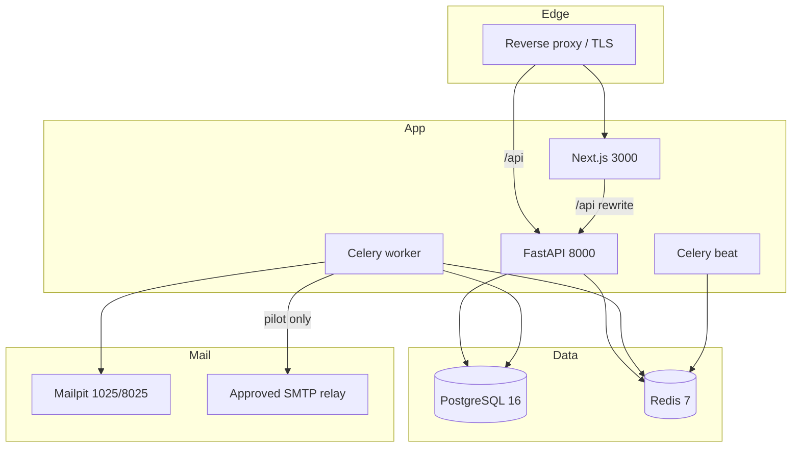
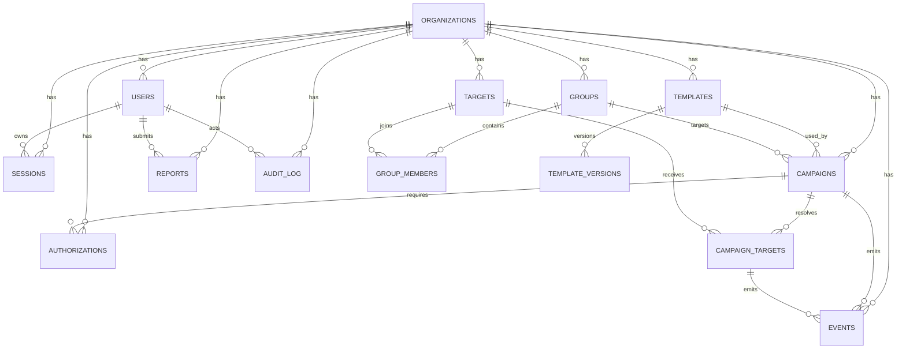
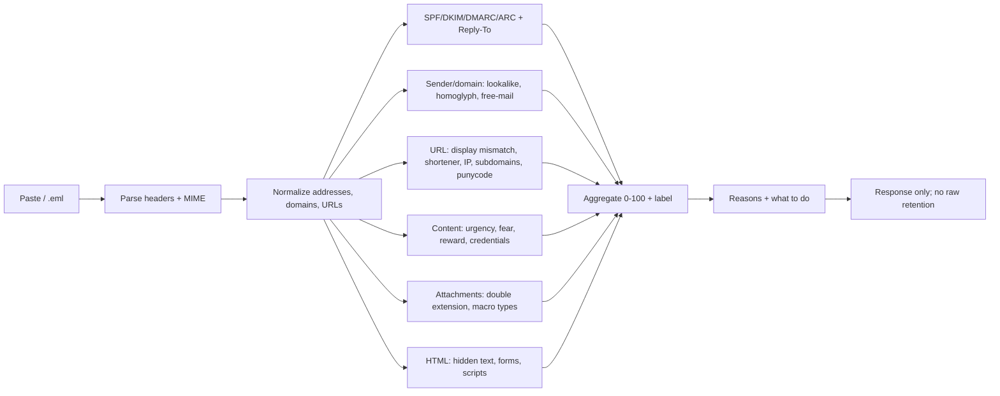
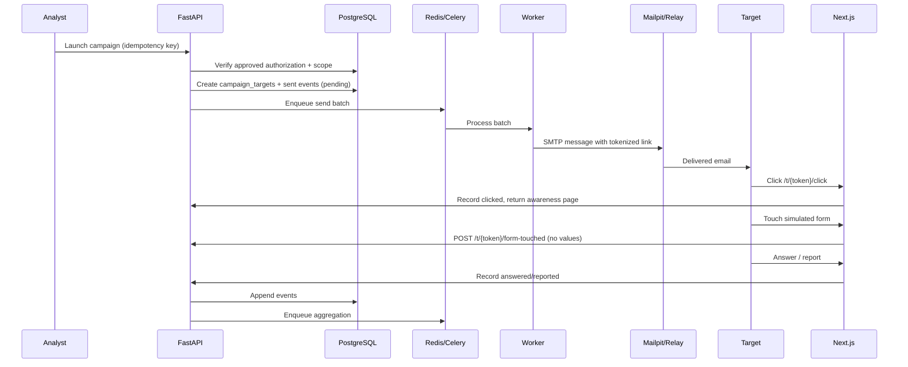

# Architecture

Scope: Phase 2–4 system design for the rebuilt platform. Requirements: [`requirements.md`](requirements.md). Threats: [`threat-model.md`](threat-model.md). Defaults: [`assumptions.md`](assumptions.md). Design rules: [`design-system.md`](design-system.md).

---

## 1. Design goals

1. **Safety before delivery.** No send without a matching approved authorization.
2. **Minimal, explainable data.** Collect interaction events, never credentials or raw mailbox content.
3. **Clear separation.** Next.js UI, FastAPI domain API, Celery workers, PostgreSQL, Redis, Mailpit/relay, and a versioned detection library.
4. **Server-authoritative.** Authorization, scoring, reporting and retention are enforced server-side.
5. **Accessible by default.** The UI is built from the design system, keyboard-first and WCAG 2.2 AA.
6. **Operable.** Structured logs, metrics, audit log, migrations, health checks and reproducible builds.

---

## 2. System context



**Trust boundaries:** browser/API, API/database, worker/mail relay, analyzer/DNS, admin/privileged actions, CI/repository. See [`threat-model.md`](threat-model.md).

---

## 3. Container and deployment view



### 3.1 Components

| Component | Responsibility | Trust notes |
|---|---|---|
| **Next.js** | Pages, forms, accessibility, same-origin API calls, streaming/SSR where useful | Never authoritative; no secrets; no campaign state ownership |
| **FastAPI** | Auth, RBAC, campaigns, authorization, tracking endpoints, reports, analyzer API, settings, audit | Validates every request; scopes by `org_id`; enforces separation of duties |
| **PostgreSQL** | Durable state, constraints, indexes, audit | Least-privilege role; encrypted volume; backups |
| **Redis** | Celery broker/result backend, rate-limit counters, short-lived idempotency keys | No long-term PII; TTLs |
| **Celery worker** | Scheduled sends, event aggregation, retention, analyzer jobs | Idempotent tasks; no secrets in logs |
| **Celery beat** | Periodic schedules | Single instance in pilot; leader lock for scale |
| **Detection library (`ml/`)** | Rules, features, model, explanation, versioning | Pure functions where possible; no outbound URL fetch |
| **Mailpit** | Development/test SMTP catcher and UI | Loopback only; never exposed publicly |
| **Approved relay** | Pilot delivery only | Scoped credentials; domain allowlist; rate limits |
| **Reverse proxy** | TLS, security headers, same-origin routing | HSTS, CSP, frame-ancestors, request size limits |

### 3.2 Request path

- The browser talks to the Next.js origin. `/api/*` is rewritten/proxied to FastAPI so session cookies are same-origin and CSRF is practical.
- Session cookie: `__Host-session`, `HttpOnly`, `Secure`, `SameSite=Lax` (Strict for admin routes where feasible), `Path=/`.
- CSRF: synchronizer token issued with the session and required on every mutating request, plus Origin/Referer checks.
- All object access filters by `org_id` and role; no client-supplied `org_id` is trusted.

---

## 4. Domain model and database schema

### 4.1 Entity relationship diagram



### 4.2 Tables

All tables include `id uuid primary key default gen_random_uuid()` unless noted. Timestamps are `timestamptz`. Emails use `citext` (case-insensitive). Soft delete is `deleted_at`; hard delete is provided for retention.

#### `organizations`

| Column | Type | Constraints / notes |
|---|---|---|
| `name` | text | not null |
| `slug` | citext | unique, not null |
| `primary_domain` | citext | not null; validated |
| `allowed_send_domains` | text[] | not null; default `{example.com}`; only reserved sandbox or approved pilot domains |
| `retention_days` | integer | not null default 90; check 1–3650 |
| `reporting_min_group` | integer | not null default 5; check ≥3 |
| `timezone` | text | default `UTC` |
| `settings` | jsonb | non-secret preferences only |
| `created_at`, `updated_at` | timestamptz | not null |

#### `users`

| Column | Type | Constraints / notes |
|---|---|---|
| `org_id` | uuid | FK → organizations, not null |
| `email` | citext | not null; unique (`org_id`, `email`) |
| `password_hash` | text | not null; Argon2id preferred |
| `display_name` | text | not null |
| `role` | enum `admin`/`analyst`/`employee` | not null |
| `is_active` | boolean | not null default true |
| `mfa_enabled` | boolean | default false; MFA required for admins in pilot |
| `last_login_at` | timestamptz | nullable |
| `created_at`, `updated_at`, `deleted_at` | timestamptz | |

Index: `(org_id, role)`, `(org_id, is_active)`.

#### `sessions`

| Column | Type | Constraints / notes |
|---|---|---|
| `user_id` | uuid | FK → users, not null |
| `token_hash` | bytea | unique, not null; raw token never stored |
| `csrf_hash` | bytea | not null |
| `ip_hash` | bytea | nullable; salted, short retention |
| `user_agent` | text | nullable; optional |
| `created_at`, `expires_at`, `revoked_at` | timestamptz | `expires_at` indexed |

Index: `(user_id, expires_at)`. Rotate token on login and privilege change.

#### `groups`

| Column | Type | Constraints / notes |
|---|---|---|
| `org_id` | uuid | FK |
| `name` | citext | not null; unique (`org_id`, `name`) |
| `description` | text | |
| `created_by` | uuid | FK → users |
| `created_at`, `updated_at`, `deleted_at` | timestamptz | |

#### `targets`

| Column | Type | Constraints / notes |
|---|---|---|
| `org_id` | uuid | FK |
| `email` | citext | not null; unique (`org_id`, `email`) |
| `display_name` | text | not null |
| `department` | text | nullable |
| `external_id` | text | nullable; HR reference only if authorized |
| `is_active` | boolean | default true |
| `created_at`, `updated_at`, `deleted_at` | timestamptz | |

Minimal fields only. No phone, address, job title or manager by default.

#### `group_members`

| Column | Type | Constraints / notes |
|---|---|---|
| `group_id`, `target_id` | uuid | composite PK; FKs with `on delete cascade` |
| `added_at` | timestamptz | not null |

Index: `(target_id)` for reverse lookups.

#### `templates`

| Column | Type | Constraints / notes |
|---|---|---|
| `org_id` | uuid | FK |
| `name` | text | not null |
| `description` | text | |
| `technique` | enum | `T1566.001`, `T1566.002`, `T1566.003`, `T1598` |
| `difficulty` | enum | `easy`, `medium`, `hard` |
| `sender_name`, `sender_email` | text | sender domain validated against organization allowlist |
| `subject` | text | not null |
| `body_text`, `body_html` | text | HTML sanitized with an allowlist; no scripts/forms |
| `link_url` | text | nullable; sandbox only; no real-brand domains |
| `attachment_name` | text | nullable; display name only, never a real file |
| `red_flags` | jsonb | array of `{id, label, explanation}` |
| `status` | enum | `draft`, `active`, `archived` |
| `current_version` | integer | default 1 |
| `created_by` | uuid | FK → users |
| `created_at`, `updated_at`, `deleted_at` | timestamptz | |

Check: no `<script`, `<iframe`, `javascript:`, or `data:` in sanitized HTML (enforced by sanitizer + tests).

#### `template_versions`

| Column | Type | Constraints / notes |
|---|---|---|
| `template_id` | uuid | FK |
| `version` | integer | not null; unique (`template_id`, `version`) |
| `snapshot` | jsonb | immutable full snapshot |
| `created_by` | uuid | FK → users |
| `created_at` | timestamptz | |

#### `campaigns`

| Column | Type | Constraints / notes |
|---|---|---|
| `org_id` | uuid | FK |
| `name` | text | not null |
| `template_id` | uuid | FK; template version resolved at launch |
| `group_id` | uuid | FK; one group per campaign (glossary definition) |
| `status` | enum | `draft`, `awaiting_authorization`, `scheduled`, `running`, `paused`, `completed`, `cancelled`, `rejected` |
| `scheduled_at` | timestamptz | nullable until scheduled |
| `timezone` | text | default organization timezone |
| `authorization_id` | uuid | nullable FK → authorizations; required before `scheduled`/`running` |
| `created_by` | uuid | FK → users |
| `started_at`, `completed_at` | timestamptz | |
| `created_at`, `updated_at`, `deleted_at` | timestamptz | |

Check: `status in ('scheduled','running','paused','completed')` requires non-null `authorization_id`. Enforced in service + DB where practical.

#### `campaign_targets`

| Column | Type | Constraints / notes |
|---|---|---|
| `campaign_id`, `target_id` | uuid | unique pair |
| `token_hash` | bytea | unique; maps tracking token to row |
| `status` | enum | `pending`, `sent`, `delivered`, `opened`, `clicked`, `form_touched`, `answered`, `reported`, `failed` |
| `sent_at`, `opened_at`, `clicked_at`, `form_touched_at`, `answered_at`, `reported_at` | timestamptz | first-occurrence semantics |
| `answer` | enum | `phish`, `legit`, `report`; nullable |
| `failure_reason` | text | nullable; no raw provider response with PII |

Indexes: `(campaign_id, status)`, `(target_id, campaign_id)`.

#### `authorizations`

| Column | Type | Constraints / notes |
|---|---|---|
| `org_id` | uuid | FK |
| `campaign_id` | uuid | FK; unique for v1 (one active approval per campaign) |
| `requested_by` | uuid | FK → users |
| `approved_by` | uuid | FK → users, nullable |
| `status` | enum | `draft`, `pending`, `approved`, `rejected`, `expired`, `revoked`, `closed` |
| `scope` | jsonb | immutable snapshot: groups, templates, target IDs/count, domains, dates, data collected |
| `roe_version` | text | version identifier |
| `roe_hash` | text | SHA-256 of the RoE document |
| `evidence_ref` | text | encrypted document reference or external record ID |
| `conditions` | text | approver conditions |
| `requested_at` | timestamptz | |
| `approved_at`, `expires_at`, `revoked_at` | timestamptz | |
| `created_at`, `updated_at` | timestamptz | |

Check: when `status='approved'`, `approved_by` is not null and `approved_by <> requested_by`. Enforced in service + DB check.

#### `events`

| Column | Type | Constraints / notes |
|---|---|---|
| `id` | bigserial | append-only event id |
| `org_id` | uuid | FK |
| `campaign_id` | uuid | nullable FK |
| `campaign_target_id` | uuid | nullable FK |
| `target_id` | uuid | nullable FK |
| `type` | enum | `sent`, `delivered`, `opened`, `clicked`, `form_touched`, `answered`, `reported`, `analyzer_run`, `training_started`, `training_completed`, `export_created` |
| `occurred_at` | timestamptz | not null; default now |
| `metadata` | jsonb | allow-listed only; no field values, passwords, raw bodies |
| `request_id` | text | correlates with logs |
| `created_at` | timestamptz | |

Indexes: `(org_id, occurred_at)`, `(campaign_id, type)`, `(target_id, occurred_at)`. Consider monthly partitioning when events exceed pilot volume.

#### `reports` (report-phish submissions)

| Column | Type | Constraints / notes |
|---|---|---|
| `org_id` | uuid | FK |
| `reporter_user_id` | uuid | nullable FK; protected from other reporters |
| `target_id` | uuid | nullable FK |
| `source` | enum | `employee`, `analyst`, `analyzer` |
| `message_subject` | text | optional, truncated |
| `sender_display`, `sender_domain` | text | optional |
| `risk_score` | integer | 0–100, nullable |
| `label` | enum | `low`, `suspicious`, `likely_phishing` |
| `reasons` | jsonb | rule IDs + short explanations; no raw content |
| `status` | enum | `new`, `triaged`, `confirmed`, `benign`, `closed` |
| `triaged_by` | uuid | FK → users, nullable |
| `triaged_at` | timestamptz | |
| `notes` | text | triage notes; no secrets |
| `created_at`, `updated_at` | timestamptz | |

Index: `(org_id, status, created_at)`. Generated metric reports are computed; this table is for submissions.

#### `audit_log`

| Column | Type | Constraints / notes |
|---|---|---|
| `id` | bigserial | append-only |
| `org_id` | uuid | FK |
| `actor_user_id` | uuid | nullable FK (system actions) |
| `action` | text | stable action key, e.g. `campaign.launch` |
| `entity_type` | text | table/domain name |
| `entity_id` | text | string form of ID |
| `before`, `after` | jsonb | redacted diffs only |
| `reason` | text | required for individual drill-down and deletion |
| `ip_hash` | bytea | salted, optional |
| `request_id` | text | |
| `created_at` | timestamptz | |

Application role has `INSERT`/`SELECT` only; no `UPDATE`/`DELETE`. Retention longer than events (see assumptions).

#### `detection_runs`

| Column | Type | Constraints / notes |
|---|---|---|
| `org_id` | uuid | FK |
| `user_id` | uuid | FK |
| `input_type` | enum | `paste`, `eml`, `headers` |
| `content_hash` | bytea | salted hash for dedupe/abuse only; not reversible |
| `risk_score` | integer | 0–100 |
| `label` | enum | `low`, `suspicious`, `likely_phishing` |
| `reasons` | jsonb | rule IDs, evidence labels, contributions |
| `rule_version`, `model_version` | text | reproducibility |
| `created_at`, `expires_at` | timestamptz | no raw content stored |

#### `training_progress`

| Column | Type | Constraints / notes |
|---|---|---|
| `org_id` | uuid | FK |
| `user_id` | uuid | FK |
| `lesson_key` | text | content version key |
| `status` | enum | `not_started`, `in_progress`, `completed` |
| `score` | integer | nullable |
| `attempts` | integer | default 0 |
| `started_at`, `completed_at`, `updated_at` | timestamptz | |

Unique `(user_id, lesson_key)`.

### 4.3 Retention defaults

| Data | Default | Configurable | Notes |
|---|---|---|---|
| Events and campaign targets | 90 days | Yes | Hard delete or irreversible anonymization |
| Phish reports | 90 days | Yes | Keep aggregate counts |
| Detection runs | 90 days | Yes (decision pending) | No raw content stored |
| Training progress | 90 days after completion or target deletion | Yes | Employee can see own progress |
| Audit log | 365 days | Yes (decision pending) | No raw content; export audited |
| Authorization evidence | Contract/legal term | Yes (decision pending) | May be external reference |
| Sessions | 12 hours idle / 7 days absolute | Yes | Revoke on logout/role change |

---

## 5. API outline (v1)

Base: `/api/v1`. JSON unless stated. All mutating cookie-authenticated requests require `X-CSRF-Token`. All list endpoints support cursor or page pagination, bounded page size, and stable sorting. All object queries are scoped by the authenticated user's organization.

### 5.1 Conventions

- **Errors:** `{ "error": { "code": "campaign_scope_mismatch", "message": "...", "fields": {...}, "request_id": "..." } }`
- **Auth:** server-side session cookie; no bearer tokens in browser storage.
- **Idempotency:** `Idempotency-Key` on send/launch/export endpoints.
- **Rate limits:** login, report, analyzer and export endpoints; return `429` with `Retry-After`.
- **Audit:** every privileged mutation writes an audit row in the same transaction.
- **OpenAPI:** generated and committed for frontend typing.

### 5.2 Endpoints

| Method | Path | Role | Purpose |
|---|---|---|---|
| POST | `/auth/login` | public | Create session + CSRF token; rate-limited |
| POST | `/auth/logout` | authenticated | Revoke session |
| GET | `/auth/me` | authenticated | Current user, role, org, CSRF token |
| POST | `/auth/password` | authenticated | Change own password; revoke other sessions |
| GET/POST | `/users` | admin | List/invite users |
| PATCH/DELETE | `/users/{id}` | admin | Change role/deactivate; audited |
| GET/POST | `/groups` | admin, analyst | List/create groups |
| PATCH/DELETE | `/groups/{id}` | admin, analyst | Edit/delete group; audited |
| POST | `/groups/{id}/members` | admin, analyst | Add targets |
| DELETE | `/groups/{id}/members/{target_id}` | admin, analyst | Remove target |
| POST | `/groups/{id}/import` | admin, analyst | CSV import; returns row-level errors |
| GET/POST | `/targets` | admin, analyst | List/create targets |
| PATCH/DELETE | `/targets/{id}` | admin, analyst | Edit/delete target |
| GET/POST | `/templates` | admin, analyst | List/create templates |
| GET/PATCH/DELETE | `/templates/{id}` | admin, analyst | Read/version/archive |
| POST | `/templates/{id}/duplicate` | admin, analyst | Copy as draft |
| GET/POST | `/campaigns` | admin, analyst | List/create drafts |
| GET/PATCH/DELETE | `/campaigns/{id}` | admin, analyst | Read/edit/cancel draft |
| POST | `/campaigns/{id}/test-send` | admin, analyst | Send to self; excluded from metrics |
| POST | `/campaigns/{id}/authorization` | admin, analyst | Request approval |
| POST | `/campaigns/{id}/schedule` | admin, analyst | Requires approved authorization |
| POST | `/campaigns/{id}/launch` | admin, analyst | Immediate launch; requires approved authorization |
| POST | `/campaigns/{id}/pause` | admin, analyst | Pause unsent sends |
| POST | `/campaigns/{id}/resume` | admin, analyst | Resume if authorization valid |
| POST | `/campaigns/{id}/cancel` | admin, analyst | Cancel; audited |
| GET | `/authorizations` | admin, analyst | List; analysts see own requests |
| GET | `/authorizations/{id}` | admin, analyst | Scope and status |
| POST | `/authorizations/{id}/approve` | admin | Approve if not creator; audited |
| POST | `/authorizations/{id}/reject` | admin | Reject with reason |
| POST | `/authorizations/{id}/revoke` | admin | Revoke; stops sends |
| GET | `/reports` | admin, analyst | Phish submissions; group-scoped |
| POST | `/reports` | authenticated | Submit a suspicious message |
| GET | `/reports/{id}` | admin, analyst | Detail; no other reporters |
| POST | `/reports/{id}/triage` | admin, analyst | Set status and notes |
| POST | `/analyzer/analyze` | admin, analyst | JSON paste analysis (bounded) |
| POST | `/analyzer/eml` | admin, analyst | Multipart `.eml` (max 5 MB) |
| GET | `/analyzer/runs` | admin, analyst | Metadata only; no raw content |
| GET | `/metrics/summary` | admin, analyst | Dashboard aggregates |
| GET | `/metrics/campaigns/{id}` | admin, analyst | Campaign funnel |
| GET | `/metrics/trends` | admin, analyst | Trend series |
| POST | `/metrics/export` | admin, analyst | CSV; audited; formula-injection safe |
| GET/PATCH | `/settings` | admin | Org, retention, reporting threshold, domains |
| POST | `/settings/delete-data` | admin | Scoped deletion; typed confirmation; audited |
| GET | `/audit` | admin | Filterable audit log |
| GET | `/training/lessons` | authenticated | Lesson list for own role |
| POST | `/training/{lesson_key}/answer` | authenticated | Record answer, return explanation |
| GET | `/health/live` | internal | Liveness |
| GET | `/health/ready` | internal | DB/Redis readiness |

### 5.3 Tracking endpoints (tokenized, not session-authenticated)

| Method | Path | Purpose | Notes |
|---|---|---|---|
| GET | `/t/{token}/click` | Record click, redirect to awareness page | Token hashed lookup; no PII in URL; rate-limited; bot filtering |
| POST | `/t/{token}/form-touched` | Record `form_touched` only | Accepts no fields; rejects unexpected body with `400` |
| GET | `/p/{token}` | Awareness page data | Red flags and tips only |
| POST | `/p/{token}/answer` | Record phish/legit/report answer | Bounded; idempotent per target |
| POST | `/p/{token}/report` | Record report event | Same as employee report, no login required |

Tracking endpoints must not reveal whether a token exists beyond a neutral page, must not accept arbitrary metadata, and must be excluded from indexing.

### 5.4 Authorization checks

Every service method follows: authenticate → load object scoped by `org_id` → check role → check object relationship (own campaign, own group) → check state (authorization approved, campaign not closed) → validate input → mutate + audit in one transaction.

---

## 6. Detection pipeline



| Layer | Inputs | Outputs | Failure behaviour |
|---|---|---|---|
| Authentication | `Authentication-Results`, `Received-SPF`, `ARC-*` | per-mechanism pass/fail/unknown | Unknown is a reason, not a hard fail |
| Sender/domain | From, Reply-To, Return-Path, org domain | mismatch, free-mail, lookalike distance, homoglyph | Skip DNS if unavailable; never block on lookup |
| URL | hrefs, anchor text, sender domain | mismatch, shortener, IP, `@`, subdomain count, punycode | Never fetch remote URLs; parse only |
| Content | subject, body text, attachment names | weighted rule hits + model probability | Rules always available; model failure falls back |
| Attachments | filenames, declared MIME | risky extension, double extension, macro type | Never open or execute; no detonation |
| HTML | sanitized structure | hidden elements, embedded form, script | Parser limits; treat malformed as suspicious-unknown |

**Scoring:** rules produce weighted contributions; the model produces a calibrated probability in Phase 4. Aggregation is versioned. Labels: `0–29` Low risk, `30–59` Suspicious, `60–100` Likely phishing (provisional; tune with evaluation). Every response includes rule IDs, evidence, contribution and a plain-language explanation.

**Isolation:** parsing and scoring run in a worker with CPU/memory/time limits for uploads; the API enforces size limits. No outbound URL fetches, no attachment execution, no internal network access.

---

## 7. Mail delivery and event flow



### 7.1 Send rules

- One Celery task per batch; idempotency key `campaign_id + target_id`.
- Re-check authorization and scope immediately before each batch.
- Stop on `revoked`, `expired`, `paused` or `cancelled` status.
- Per-campaign and per-organization rate caps; no open relay.
- Tokenized links use opaque random tokens; token hash stored; no PII in URL.
- Bounces/failures are recorded without raw provider PII.
- Test sends are flagged and excluded from metrics.

### 7.2 Aggregation

- Events are append-only; metrics are computed from events, not mutable counters.
- Nightly and on-demand aggregation materializes summary tables or views for dashboard performance.
- Group suppression (`k < reporting_min_group`) is applied at query time, never only in the UI.

---

## 8. Security controls

| Control | Implementation |
|---|---|
| Authentication | Server-side sessions; Argon2id; optional MFA (required for admins in pilot) |
| Session cookies | `__Host-` prefix, `Secure`, `HttpOnly`, `SameSite=Lax`, idle + absolute timeout, rotation on login/role change |
| CSRF | Synchronizer token per session; `Origin`/`Referer` validation; no state-changing GET |
| Authorization | Deny by default; role + object checks in service layer; org scoping; tests for IDOR |
| Separation of duties | Approver ≠ creator; enforced in service and DB check |
| Output encoding | React escaping; email HTML sanitizer allowlist; no `dangerouslySetInnerHTML` with untrusted input |
| CSP | `default-src 'self'`; no inline scripts; `frame-ancestors 'none'`; `form-action 'self'` |
| Headers | HSTS, `X-Content-Type-Options`, `Referrer-Policy`, `Permissions-Policy` |
| SQL injection | SQLAlchemy parameterization; no string SQL |
| Rate limiting | Redis counters on auth, analyzer, report, export, tracking |
| Uploads | 5 MB `.eml`; MIME/extension checks; parse in worker; no execution; no storage |
| SSRF | No outbound URL fetch; DNS only via allowlisted resolver with timeouts |
| Secrets | Environment variables/secret manager; never logged; `.env` ignored |
| Audit | Append-only for app role; redacted; export audited |
| Retention | Scheduled job; deletion audited; backups documented |
| CI | CodeQL, gitleaks, dependency audit, tests, Playwright/axe, migration check |
| Privacy | No third-party analytics; no tracking pixels; minimal fields; k≥5 suppression |

---

## 9. Reliability, performance and scale

| Concern | Approach |
|---|---|
| Idempotent sends | Unique `(campaign_id, target_id)` + idempotency keys |
| Retries | Celery retry with backoff for transient SMTP/DB errors; dead-letter/alert after max attempts |
| Duplicate events | First-occurrence timestamps; unique constraints where appropriate; event insert idempotency by token/type |
| Queue isolation | Analyzer and send queues separated; retention/aggregation on a low-priority queue |
| Timeouts | HTTP, DB, SMTP and parser timeouts; bounded retries |
| Performance | Indexed queries; pagination; materialized summaries; dashboard p95 under 2s (pilot) |
| Scale | Stateless API behind proxy; multiple workers; PostgreSQL connection pooling; Redis TTLs |
| Backups | Encrypted, tested restore, retention aligned with policy |
| Observability | Structured JSON logs with request IDs; metrics (sends, failures, queue depth, latency, analyzer errors); alerts for failed sends and auth anomalies |
| Migrations | Alembic; forward-only in production; expand/contract for destructive changes |

---

## 10. Environment and configuration

```text
ENV=development|test|production
APP_BASE_URL=https://...
API_BASE_URL=https://.../api
DATABASE_URL=postgresql+psycopg://...
REDIS_URL=redis://...
SESSION_SECRET=...                 # >=32 bytes, rotated with care
CSRF_SECRET=...
SMTP_HOST=mailpit                  # pilot: approved relay
SMTP_PORT=1025
SMTP_FROM=sandbox@example.test
SMTP_USERNAME=...                  # pilot only
SMTP_PASSWORD=...                  # pilot only
ALLOWED_SEND_DOMAINS=example.com,example.test
RETENTION_DAYS=90
REPORTING_MIN_GROUP=5
ANALYZER_MAX_UPLOAD_MB=5
ANALYZER_MAX_PASTE_MB=2
RATE_LIMIT_*...
LOG_LEVEL=info
```

- `.env` and `.env.*` are git-ignored. Production uses a secret manager.
- Mailpit is bound to loopback and never exposed through the proxy.
- Docker Compose provides local Postgres, Redis, Mailpit, API, worker, beat and frontend.
- CI uses ephemeral services; no real `.eml` fixtures in the repository (use synthetic samples).

---

## 11. Phase mapping

| Phase | Architecture scope |
|---|---|
| 1 | This design, schema, API outline, threat model, wireframes |
| 2 | Auth/sessions/CSRF, org settings, groups/targets/CSV, templates, campaigns, authorization gate, Mailpit send, audit foundation |
| 3 | Tracking endpoints, events, awareness, training, metrics, reports, export |
| 4 | Detection library, analyzer endpoints/UI, model versioning, evaluation |
| 5 | Usability/accessibility/evaluation fixes, hardening and final docs |

---

## 12. Open architectural decisions

Tracked in [`assumptions.md`](assumptions.md):

- Single-tenant per deployment vs multi-tenant in one database.
- Session TTL and admin re-authentication window.
- Whether analyzer result metadata is retained for 90 days or discarded immediately.
- Whether campaigns support multiple groups in a later version.
- Whether detection runs in-process or as a separate service at scale.
- Whether exports are streamed or stored encrypted for a short period.
- MFA requirement and method (TOTP vs passkeys/FIDO2).
- Object storage need for authorization evidence.
