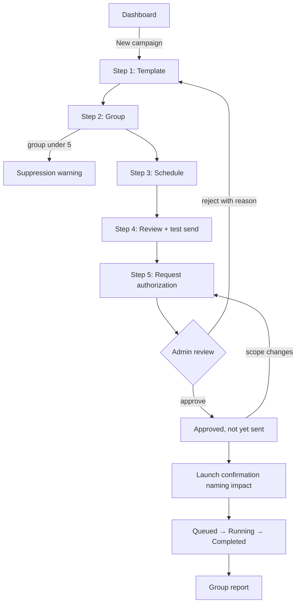
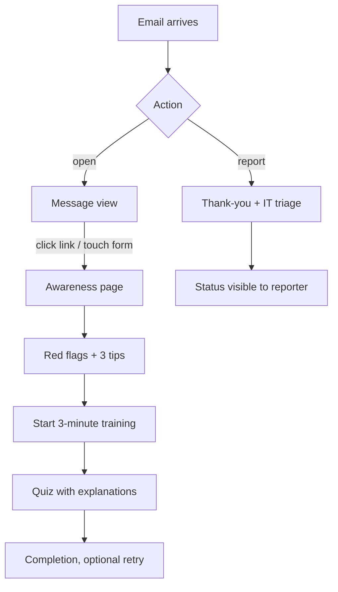
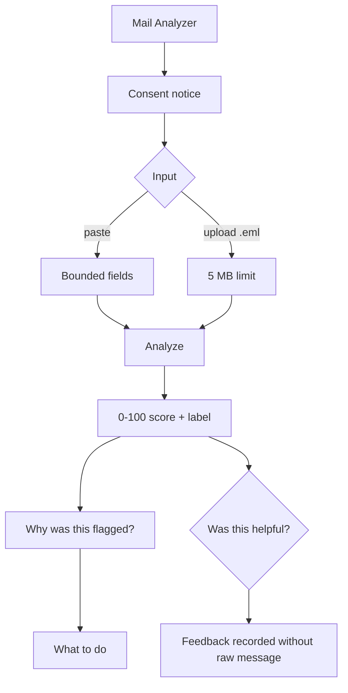
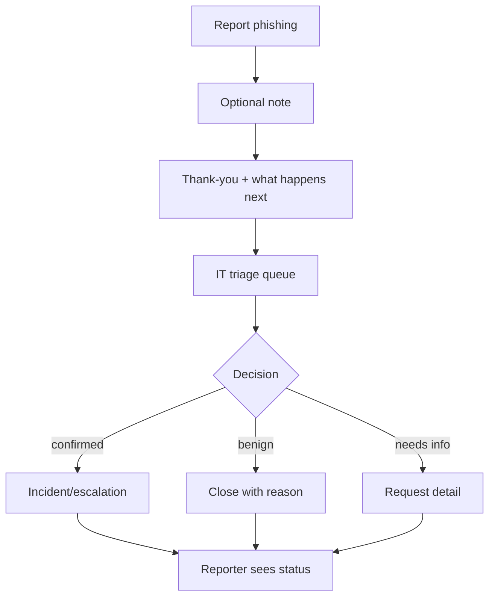
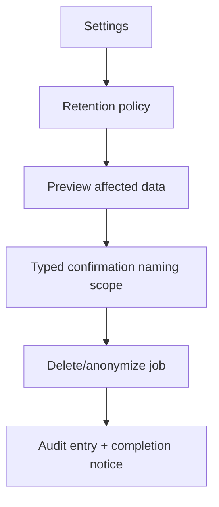

# HCI, Accessibility and Wireframe Specifications

Design source of truth: [`design-system.md`](design-system.md). Scope: [`PLAN.md`](PLAN.md). Requirements: [`requirements.md`](requirements.md).

This document adds personas, flows, per-page heuristic checks and wireframe/state specifications. It does **not** redefine tokens, type, components or copy rules; those stay in the design system.

---

## 1. Experience principles

| Principle | Application |
|---|---|
| Safety is visible | Authorization status, sandbox domain, target count and retention are shown before launch |
| Calm authority | No alarmist language; risk is explained, not shouted |
| Blame-free learning | "No harm done"; no individual ranking; reporting is praised |
| One primary action | Each screen has exactly one primary button; secondary actions are grouped |
| Recognition over recall | Steppers, saved groups, template previews, inline definitions |
| Explainability | Every risk score opens "Why was this flagged?" with evidence |
| Reversibility | Draft autosave, undo, pause/cancel, confirmations naming impact |
| Accessible by default | Keyboard, focus, contrast, zoom, reduced motion and screen-reader labels are acceptance criteria |

---

## 2. Personas

### P-01 Ayesha — IT Security Administrator (primary admin)

- **Age/context:** 34, security lead at a 600-person company; accountable to management and legal.
- **Goals:** run a compliant programme, prove authorization, stop misuse, see group trends, export evidence.
- **Frustrations:** unclear approval state, surprise sends, tools that encourage shaming, reports she cannot defend.
- **Behaviours:** keyboard-heavy, uses a large monitor, checks audit and settings, rarely creates templates.
- **Needs:** one-screen launch readiness, approval separation, retention controls, audit export, clear warnings.
- **Accessibility:** standard vision; prefers high information density with clear hierarchy.

### P-02 Bilal — Security Analyst (primary campaign operator)

- **Age/context:** 28, two years in security operations; builds campaigns and triages reports.
- **Goals:** create realistic scenarios quickly, test rendering, schedule safely, understand results, tune detection.
- **Frustrations:** repetitive data entry, unclear validation, false positives without reasons, missing templates.
- **Behaviours:** works in bursts, uses filters and keyboard shortcuts, tests on mobile widths, analyzes `.eml` files.
- **Needs:** template gallery, CSV import with row errors, draft autosave, test send, analyzer reasons, group reports.
- **Accessibility:** standard vision; power user who benefits from shortcuts and bulk actions.

### P-03 Sara — HR Employee (target and learner)

- **Age/context:** 41, non-technical, busy, checks email on a phone between meetings.
- **Goals:** do her job, avoid embarrassment, know what to do when something looks wrong.
- **Frustrations:** blame, jargon, long training, unclear "report" consequences, tiny tap targets.
- **Behaviours:** scans subject/sender, taps links, rarely reads policy pages, may report only if easy.
- **Needs:** short blame-free awareness page, obvious "Report phishing", plain language, mobile-first layout, no scoreboard.
- **Accessibility:** standard vision; sometimes distracted, one-handed use, needs large targets and clear focus.

### P-04 Maria — Finance Employee with low vision (accessibility persona)

- **Age/context:** 52, uses 200% browser zoom and a screen reader for long documents.
- **Goals:** complete training and report suspicious mail independently.
- **Frustrations:** unlabeled icons, color-only status, focus loss in dialogs, charts without text alternatives.
- **Behaviours:** keyboard and screen reader, high contrast, prefers reduced motion.
- **Needs:** semantic landmarks, visible focus, icon + text status, table alternatives, no keyboard traps, reflow at 320px.

### 2.1 Persona-to-feature map

| Need | Ayesha | Bilal | Sara | Maria |
|---|---|---|---|---|
| Authorization status and audit | ● | ○ | | |
| Template library and preview | ○ | ● | | |
| CSV import and groups | ○ | ● | | |
| Short awareness page | | | ● | ● |
| One-click report | ○ | ○ | ● | ● |
| Accessible charts/tables | ○ | ○ | | ● |
| Analyzer with reasons | ○ | ● | ○ | ○ |
| Retention and deletion | ● | | | |
| Keyboard-only operation | ● | ● | ○ | ● |

**Note:** All single-key shortcuts follow **WCAG 2.1.4** (use a modifier key, or provide an option to turn them off or remap them).

● primary need ○ secondary need

---

## 3. Task flows

### 3.1 Create, authorize and launch a campaign (Bilal → Ayesha)



**Design requirements:** stepper shows "Step 2 of 5"; draft autosaves; back preserves data; the primary action is "Next" until review, then "Request authorization"; launch is a separate confirmed action; approval state is visible everywhere.

### 3.2 Employee experiences a simulation (Sara/Maria)



**Design requirements:** awareness appears immediately; no login wall; under three minutes; no data collected beyond the event; training can be exited and resumed; reporting is one click and never framed as failure.

### 3.3 Analyze a real email (Bilal)



**Design requirements:** consent is explicit; errors are specific; score is not color-only; reasons name evidence; "What to do" is actionable; raw content is not retained by default.

### 3.4 Report and triage (Sara → Bilal)



**Design requirements:** reporters see status but not other reporters; triage notes are internal; group-level reporting is unaffected; no punishment.

### 3.5 Retention and deletion (Ayesha)



---

## 4. Accessibility requirements

These apply to every page and are part of the definition of done.

### 4.1 Perceivable

- Body text ≥4.5:1; large text ≥3:1; UI boundaries/icons ≥3:1 (tokens already checked).
- Never color-only: every status has icon + text label.
- Charts have a data table or text summary within the same page.
- Informative images have alt text; decorative images are hidden from assistive tech.
- Email preview provides a text alternative and does not rely on remote images.
- Video/animation has a pause control if longer than 5 seconds; reduced motion is honoured.

### 4.2 Operable

- Full keyboard access, logical tab order, skip link, no traps.
- Visible focus ring: 2px, ≥3:1 against adjacent colors, not obscured by sticky headers.
- Targets ≥44×44px (design system; exceeds WCAG 2.2 AA 24×24 minimum).
- No drag-only interactions.
- Timeouts warn and allow extension; draft work is preserved.
- No auto-advancing carousels or autoplay audio.

### 4.3 Understandable

- One `h1` per page; logical heading order; landmarks (`header`, `nav`, `main`, `footer`).
- Visible labels (not placeholder-only); helper text; inline errors linked with `aria-describedby`.
- Errors say what happened, where, and how to fix it; input is not cleared.
- Consistent navigation, button labels and status language.
- Accessible authentication: paste allowed, password managers supported, no cognitive tests, password reveal available.
- Redundant entry is avoided across steps (WCAG 2.2 AA 3.3.7).

### 4.4 Robust

- Native HTML first; ARIA only when needed; names/roles/states correct.
- Dialogs trap focus, close with Esc, and return focus to the trigger.
- Toasts are polite live regions, persist ≥6 seconds, and offer Undo where possible.
- Tables use real headers, scope and caption; sortable headers are buttons.
- Works at 320px width and 200% zoom without horizontal page scroll.
- Tested with axe-core in Playwright; no serious or critical issues.
- Manual spot checks with keyboard, screen reader (NVDA/VoiceOver) and reduced motion.

### 4.5 Screen-reader specifics

| Element | Requirement |
|---|---|
| Campaign progress | `aria-current="step"` plus "Step 2 of 5" text |
| Risk badge | Accessible name: "Likely phishing, high risk" |
| Score bar | `role="meter"` or text "72 out of 100, likely phishing" |
| Charts | Hidden from AT if a complete table alternative is present; otherwise labelled |
| Suppressed group | Text "Too small to report" plus explanation |
| Simulated form | Explanatory text; if any form exists, it accepts no values; no password field |
| Tokenized awareness page | `lang` set, meaningful title, no login requirement |

---

## 5. Global layout shell

```text
┌─────────────────────────────────────────────────────────────────────┐
│ Skip to main content                                                 │
│ ┌───────────────┐ ┌───────────────────────────────────────────────┐ │
│ │ Sidebar 240px │ │ Top bar: page title · org · theme · account   │ │
│ │               │ ├───────────────────────────────────────────────┤ │
│ │ Overview      │ │ Main content (max 1136px)                     │ │
│ │ Campaigns     │ │ ┌───────────────────────────────────────────┐ │ │
│ │ Templates     │ │ │ Page header: h1 + supporting text + CTA   │ │ │
│ │ Groups        │ │ ├───────────────────────────────────────────┤ │ │
│ │ Reports       │ │ │ Content: cards, tables, forms             │ │ │
│ │ Analyzer      │ │ │                                           │ │ │
│ │ Reports queue │ │ │                                           │ │ │
│ │ Settings      │ │ └───────────────────────────────────────────┘ │ │
│ │               │ │                                               │ │
│ └───────────────┘ └───────────────────────────────────────────────┘ │
│ Footer: safety notice · documentation · version                     │
└─────────────────────────────────────────────────────────────────────┘
```

- Sidebar collapses into a menu button below 1024px.
- Primary action sits top-right on desktop and full-width at the bottom on mobile.
- One `h1`; section titles are `h2`; card titles are `h3` when nested.
- The safety notice ("Authorized simulations only") is persistent but not noisy.

---

## 6. Page specifications

Each page includes: purpose, primary action, wireframe regions, key components, heuristic checks, and states. Copy follows [`design-system.md`](design-system.md) §9.

### 6.1 Login

**Purpose:** authenticate without leaking account existence or credentials.
**Primary action:** Sign in.

| Region | Content |
|---|---|
| Center card | Product name, one-sentence purpose, authorization notice |
| Form | Email, password with reveal, "Sign in" |
| Help | "Forgot password?" (if enabled), support contact, no credential hints |
| Footer | Privacy and acceptable-use links |

**Heuristic checks**
- Visibility: loading state on submit ("Signing in…").
- Match: plain labels; no jargon.
- Control: password reveal, back to previous page where safe.
- Consistency: same input/button components.
- Error prevention: rate-limit message, no account enumeration.
- Recognition: password manager autocomplete; no memory puzzles.
- Flexibility: Enter submits; keyboard-only.
- Minimalist: nothing except sign-in and help.
- Recovery: clear, non-blaming error; input preserved.
- Help: support link and authorization notice.

**States**

| State | Behaviour |
|---|---|
| Empty | Focus on email; no inline errors until submit |
| Loading | Button disabled with text; polite live status |
| Error | Inline alert "Email or password is incorrect"; focus moves to alert; input preserved; attempt throttled |
| Success | Redirect to role home; session cookie set; no token in URL |
| Locked | Explain wait time and support path; do not reveal whether the account exists |

### 6.2 Dashboard

**Purpose:** answer "what is happening and what should I do next?" in under 10 seconds.
**Primary action:** New campaign (admin/analyst); for employees, Start training.

| Region | Content |
|---|---|
| Page header | "Overview", date range, primary CTA |
| KPI row | 4 numbers: active campaigns, click rate, report rate, training completion |
| Attention panel | **Admin notice:** Pending approvals (with count); Authorization pending; campaigns needing review; groups below reporting threshold |
| Funnel/trend | Campaign funnel and trend chart with table alternative |
| Recent activity | Last campaigns and reports (group-level) |
| Empty state | "No campaigns yet. Create your first one…" |

**Heuristic checks**
- Visibility: live status chips (Draft/Running/Paused/Completed) with icon + text.
- Real world: "people who clicked" and denominators, not raw jargon.
- Control: filters and date range; details on demand.
- Consistency: one primary CTA; risk colors reserved.
- Error prevention: no destructive action on dashboard.
- Recognition: saved date ranges and recent campaigns.
- Flexibility: **keyboard shortcut for new campaign uses a modifier key, or can be turned off/remapped to meet WCAG 2.1.4**; filters persist in session.
- Minimalist: four KPIs first; details below.
- Recovery: failed widget shows retry, not a blank page.
- Help: inline definitions for metrics.

**States**

| State | Behaviour |
|---|---|
| Empty | Explanation + "New campaign"; no fake numbers |
| Loading | Skeletons for KPIs and charts (over 300ms) |
| Partial error | Per-widget error with retry; other widgets remain |
| Success | Numbers + table alternatives + "Updated just now" |
| Suppressed | "Too small to report" for groups under k |

### 6.3 Campaign Creator

**Purpose:** guide a safe campaign from template to approved launch.
**Primary action:** Next → Request authorization → Launch (contextual).

| Step | Content | Primary action |
|---|---|---|
| 1 Template | Searchable gallery, preview, difficulty, ATT&CK, red flags | Next |
| 2 Group | Group picker, target count, suppression warning, CSV import link | Next |
| 3 Schedule | Date/time, timezone, send window, rate cap | Next |
| 4 Review | Summary, test send, checklist, warnings | Send test / Next |
| 5 Launch | Authorization status, confirmation naming impact | Request authorization / Launch |

**Wireframe regions:** stepper at top; form card center; summary sidebar on desktop; sticky action bar at bottom on mobile; "Save draft" secondary; "Cancel" in overflow with confirmation.

**Heuristic checks**
- Visibility: "Step 2 of 5", autosave status, approval state.
- Real world: "Send to 120 people in Finance on 12 Nov at 10:00", not internal codes.
- Control: back, cancel, pause later, discard confirmation.
- Consistency: same stepper, buttons and validation across steps.
- Error prevention: launch checklist, **test send only to the creator's own verified address or the Mailpit sandbox inbox (never the target group)**, scope binding, confirmation.
- Recognition: template thumbnails, saved groups, defaults shown.
- Flexibility: keyboard navigation, duplicate campaign later, bulk group import.
- Minimalist: one decision per step; advanced options collapsed.
- Recovery: field-level errors preserved; scope change invalidates approval with explanation.
- Help: inline "Why do I need authorization?" and retention explanation.

**States**

| State | Behaviour |
|---|---|
| Empty draft | Defaults; "Choose a template" |
| Loading | Save indicator; disabled navigation during save |
| Error | Field-linked errors; summary at top; no data loss |
| Success | "Draft saved", "Test sent", "Campaign scheduled", "Authorization requested" |
| Blocked | Approval missing/expired/revoked; explains next step; launch disabled |
| Scope changed | Warning that approval is invalid; requires re-request |

### 6.4 Template Library

**Purpose:** choose a safe, relevant simulation and understand its red flags.
**Primary action:** Use template.

| Region | Content |
|---|---|
| Header | Search, filters (difficulty, technique, status, language), primary "New template" for admins/analysts |
| Grid/list | Cards with name, difficulty badge, ATT&CK ID, red-flag count, status, updated date |
| Detail/preview | Sanitized desktop/mobile preview, red-flag toggle, "Use template" |
| Empty | "No templates match…"; clear filters; create action |

**Heuristic checks**
- Visibility: selected filters and result count.
- Real world: names and previews, not internal IDs.
- Control: back to results; close preview with Esc.
- Consistency: badge and difficulty language.
- Error prevention: warn if template is archived or uses an unapproved domain.
- Recognition: thumbnails and filters; no memorizing IDs.
- Flexibility: keyboard grid navigation, bulk duplicate, search.
- Minimalist: card shows only decision-relevant fields; details on demand.
- Recovery: preview failure shows text version and retry.
- Help: tooltip explains ATT&CK ID and difficulty.

**States**

| State | Behaviour |
|---|---|
| Empty | No templates yet / no results with clear filters |
| Loading | Skeleton cards |
| Error | Retry + "Create a template" |
| Success | Grid + count + preview |
| Archived | Read-only warning; duplicate to edit |

### 6.5 Target Groups

**Purpose:** manage authorized recipients with minimum data and safe imports.
**Primary action:** Add targets / Import CSV.

| Region | Content |
|---|---|
| Header | Search, group picker, primary "New group" |
| Group list | Name, member count, department, updated |
| Detail | Members table, add/remove, CSV import, suppression warning |
| Import panel | Template download, file input, row-level error table |
| Empty | "No groups yet. Create a group or import a CSV." |

**Heuristic checks**
- Visibility: member count, suppression status, import progress.
- Real world: "Row 7: invalid email", not "validation error".
- Control: remove member with undo; cancel import.
- Consistency: table and form patterns.
- Error prevention: duplicate email detection, minimum data, file limits.
- Recognition: saved groups, search, column mapping.
- Flexibility: bulk paste/import, keyboard row actions.
- Minimalist: only email + display name required.
- Recovery: partial import with valid rows retained and invalid rows downloadable.
- Help: CSV format guide and privacy note.

**States**

| State | Behaviour |
|---|---|
| Empty | Explanation + create/import |
| Loading | Table skeleton; import progress |
| Error | Row-level table; file-level error; retry |
| Success | Count + "Imported 38 of 40; fix 2 rows" |
| Suppressed | "This group has 3 members; reports will be suppressed" |

### 6.6 Email Preview

**Purpose:** verify rendering and red flags before use.
**Primary action:** Close preview.

| Region | Content |
|---|---|
| Header | Template name, difficulty, ATT&CK, close button |
| Toggle | Red flags on/off; desktop/mobile |
| Canvas | Sanitized email in a labelled container/iframe; no remote content |
| Side panel | Red-flag list with icons; "What the learner sees" |
| Footer | "Use template" (secondary) |

**Heuristic checks**
- Visibility: current viewport and red-flag state.
- Real world: looks like a mail client without impersonating a real brand.
- Control: close, switch viewport, toggle flags.
- Consistency: preview matches awareness page.
- Error prevention: no real links; external images blocked.
- Recognition: flags visible next to evidence.
- Flexibility: keyboard toggle; responsive.
- Minimalist: preview and flags only.
- Recovery: render failure shows text version.
- Help: explains "This is a simulation".

**States**

| State | Behaviour |
|---|---|
| Empty | "Select a template" |
| Loading | Preview skeleton; no layout shift |
| Error | Text fallback + retry |
| Success | Desktop/mobile render + flags |
| Unsafe content | Blocked with explanation; cannot use until fixed |

### 6.7 Awareness Page

**Purpose:** turn a click into a short, blame-free learning moment.
**Primary action:** Start 3-minute training (or Close).

| Region | Content |
|---|---|
| Hero | "This was a phishing simulation"; "No harm done, no information saved" |
| Evidence | The message preview with red flags highlighted (icon + text) |
| Tips | Exactly three practical tips |
| Actions | Start training (primary), Report a real phish (secondary), Close |
| Footer | Privacy note and support link |

**Heuristic checks**
- Visibility: clear simulation label; no ambiguity.
- Real world: plain language, no jargon.
- Control: close at any time; no forced sequence.
- Consistency: same risk language as the rest of the app.
- Error prevention: no form fields; no credential prompt.
- Recognition: highlights the exact signs, not a generic lecture.
- Flexibility: works on mobile, keyboard and screen reader.
- Minimalist: under three minutes; three tips only.
- Recovery: no dead ends; support link.
- Help: explains what to do next.

**States**

| State | Behaviour |
|---|---|
| Loading | Immediate shell; no spinner longer than 300ms |
| Success | Simulation label + flags + tips |
| Already answered | Shows feedback and training state |
| Error | Static fallback with tips; no tracking failure blocks content |
| Reduced motion | No animation; all content visible |

### 6.8 Training and Quiz

**Purpose:** teach recognition and response with immediate explanations.
**Primary action:** Submit answer / Continue.

| Region | Content |
|---|---|
| Header | Lesson title, "Question 2 of 5", exit |
| Progress | Steps with text, not color-only |
| Question | Scenario excerpt, answer choices (radio/checkbox), submit |
| Feedback | Correct/incorrect, why, one tip, next |
| Completion | Summary, retry, back to dashboard |

**Heuristic checks**
- Visibility: progress and saved state.
- Real world: scenarios, not abstract definitions.
- Control: exit and resume; retry; back.
- Consistency: one question pattern.
- Error prevention: confirm exit with unsaved answer.
- Recognition: choices visible; no memorized codes.
- Flexibility: keyboard selection; skip explanation on repeat.
- Minimalist: one question per screen.
- Recovery: wrong answer explains, never shames; retry available.
- Help: glossary link.

**States**

| State | Behaviour |
|---|---|
| Empty | Lesson intro + start |
| Loading | Question skeleton |
| Error | Retry; progress preserved |
| Correct | Explanation + next |
| Incorrect | Explanation + "Try again" or next |
| Completed | Summary + retry; no ranking |

### 6.9 Reports

**Purpose:** understand group-level outcomes and choose training actions.
**Primary action:** Export (secondary to viewing); "View campaign" contextual.

| Region | Content |
|---|---|
| Header | Date range, campaign/group filters, export |
| KPI row | Sent, click rate, report rate, time-to-report, repeat-clicker trend |
| Funnel | Delivered → opened → clicked → form touched → reported → answered |
| Trends | Time series with table alternative |
| Comparison | Department/group bars with suppression |
| Table | Campaign rows, denominators, definitions |
| Actions | "Plan training for this group" |

**Heuristic checks**
- Visibility: denominators, definitions, last-updated time.
- Real world: rates labelled "of delivered" etc.
- Control: filters, reset, export.
- Consistency: same status colors and terms.
- Error prevention: no individual rows by default; confirm export scope.
- Recognition: saved filters; chart legends.
- Flexibility: CSV export; keyboard table navigation.
- Minimalist: five KPIs, details below.
- Recovery: partial-data warning; retry.
- Help: metric definitions and statistical caveats.

**States**

| State | Behaviour |
|---|---|
| Empty | "No results for this period"; adjust filters |
| Loading | Skeletons; keep filters visible |
| Error | Retry; preserve filters |
| Success | KPIs + charts + table + export |
| Suppressed | "Too small to report" and reason |
| Partial | "Some events excluded by retention" notice |

### 6.10 Mail Analyzer

**Purpose:** score a real email and explain why, without retaining it.
**Primary action:** Analyze.

| Region | Content |
|---|---|
| Header | Title + consent notice + privacy note |
| Input tabs | Paste or Upload `.eml` (tabs with keyboard support) |
| Paste fields | Sender, link, subject/body, attachment names |
| Upload | File picker, 5 MB limit, accepted types |
| Result | Score meter, label, "Why was this flagged?", "What to do", link list |
| Feedback | "Was this helpful?" |

**Heuristic checks**
- Visibility: analyzing state, score, label, rule count.
- Real world: plain reasons ("The sender domain looks like PayPal but is not").
- Control: clear input, analyze again, close result.
- Consistency: same risk labels and badges everywhere.
- Error prevention: consent checkbox, size/type validation, no URL fetching.
- Recognition: sample loader, remembered org domain.
- Flexibility: keyboard, paste, upload.
- Minimalist: three inputs; advanced fields collapsed.
- Recovery: malformed MIME error with guidance; partial results if some layers fail.
- Help: "How scoring works" and privacy explanation.

**States**

| State | Behaviour |
|---|---|
| Empty | Consent + input; no result panel |
| Loading | "Analyzing…" with cancel where feasible |
| Error | Specific error (too large, unsupported, malformed) + retry |
| Success | Score + label + reasons + actions |
| Partial | "Header checks unavailable" warning; content result still shown |
| No flags | "No strong red flags found. Stay careful anyway." |

### 6.11 Report Phish

**Purpose:** let anyone report a suspicious message in one step and see what happens.
**Primary action:** Report phishing.

| Region | Content |
|---|---|
| Header | "Report a suspicious email" + safety note |
| Form | Optional sender/subject, optional note, consent for metadata |
| Confirmation | Thank-you, what happens next, status link |
| Triage (analyst) | Queue, filters, detail, status, notes, escalate |
| Empty | "No reports in this view" |

**Heuristic checks**
- Visibility: submission status; triage status.
- Real world: "We will check it and tell you what to do."
- Control: cancel, edit before submit, close.
- Consistency: same report action from email/awareness.
- Error prevention: no raw attachments required; size limits; duplicate warning.
- Recognition: prefilled sender/subject from the message.
- Flexibility: one-click from awareness; optional detail.
- Minimalist: one required action.
- Recovery: failure keeps input; retry.
- Help: "When to report" and "What not to send".

**States**

| State | Behaviour |
|---|---|
| Empty | Explanation + form |
| Loading | Submitting state |
| Error | Retry; preserve note; no raw content in logs |
| Success | Thank-you + next steps + status |
| Triage new | Highlighted, sorted by age |
| Triage closed | Read-only with outcome |

### 6.12 Settings

**Purpose:** configure safety, privacy and access without accidental damage.
**Primary action:** Save changes (contextual).

| Region | Content |
|---|---|
| Tabs | Organization, Sending domains, Retention, Reporting, **Approvals**, Users & roles, Audit log |
| Organization | Name, primary domain, timezone |
| Sending domains | Allowlist; reserved domains only in dev; pilot domain warning |
| Retention | Days, preview affected data, delete-all |
| Reporting | **Minimum group size has a hard floor of 5; admins can raise it but not lower it.** Individual-detail policy (admin-only with logged reason). |
| Approvals | **Pending requests** with scope/dates/domains summary; approve or reject with reason. **Approver must not be the creator**. |
| Users | Invite, role, deactivate |
| Audit | Filters, export, read-only |
| Danger zone | Delete data with typed confirmation |

**Heuristic checks**
- Visibility: current values, last saved, affected records.
- Real world: "Delete data older than 90 days", not internals.
- Control: cancel edits, confirm destructive actions, undo where safe.
- Consistency: same forms and danger styling.
- Error prevention: typed confirmation, scope preview, last-admin guard.
- Recognition: defaults and explanations.
- Flexibility: keyboard, filters, export.
- Minimalist: grouped tabs; advanced options collapsed.
- Recovery: validation errors preserve input; deletion is explicit.
- Help: retention and audit explanations.

**States**

| State | Behaviour |
|---|---|
| Empty | Defaults shown with explanation |
| Loading | Skeleton; save disabled until loaded |
| Error | Field-linked; no silent failure |
| Success | "Settings saved" + audit entry |
| Danger | Typed scope confirmation; progress; completion |
| Read-only | Analyst/employee see no settings (403 page) |

---

## 7. Cross-page state matrix

| Page | Empty | Loading | Error | Success | Special |
|---|---|---|---|---|---|
| Login | Focus email | Button text | Non-enumerating alert | Redirect | Locked/throttled |
| Dashboard | Create campaign CTA | KPI/chart skeletons | Per-widget retry | KPIs + table alternatives | Suppressed groups; **Pending approvals (admin)** |
| Campaign Creator | Choose template | Autosave indicator | Field + summary errors | Draft/test/scheduled | Approval blocked; scope changed |
| Template Library | No templates/results | Card skeletons | Retry + create | Grid + preview | Archived read-only |
| Target Groups | Create/import | Table skeleton | Row-level CSV errors | Imported count | Under-k warning |
| Email Preview | Select template | Preview skeleton | Text fallback | Desktop/mobile | Unsafe content blocked |
| Awareness | Immediate shell | <300ms | Static fallback | Flags + tips | Reduced motion |
| Training | Lesson intro | Question skeleton | Retry | Explanation + next | Completed, retry |
| Reports | No results | Skeletons | Retry | KPIs + table | Suppressed/partial |
| Mail Analyzer | Consent + form | Analyzing | Specific error | Score + reasons | Partial layers |
| Report Phish | Explanation | Submitting | Retry | Thank-you | Triage statuses |
| Settings | Defaults | Skeleton | Field errors | Saved + audit | Danger confirmation; **Approvals tab** |

---

## 8. Keyboard and focus model

| Context | Keys / behaviour |
|---|---|
| Global | `Tab`/`Shift+Tab`, `Enter`/`Space`, skip link first. **Shortcuts:** use modifier keys or allow turning off/remapping per WCAG 2.1.4. |
| Navigation | Arrow keys within menus; `Esc` closes; focus returns to trigger |
| Dialogs | Focus trapped; `Esc` closes; initial focus on least destructive control |
| Stepper | `Enter` advances; back button; no auto-advance |
| Tables | Sortable headers are buttons; row actions reachable; no keyboard trap in scroll container |
| Tabs | Arrow keys switch; `Home`/`End`; panel labelled |
| Analyzer | `Ctrl/Cmd+Enter` analyzes; error focus moves to alert |
| Toasts | Polite live region; Undo focused only if safe |
| Charts | Table alternative reachable; no keyboard-only hover data |

---

## 9. Content and terminology

Use the glossary and message patterns from [`design-system.md`](design-system.md) §9. Additions:

| Term | Meaning |
|---|---|
| Authorization | Signed approval covering scope, dates and domains |
| Approver | Admin who is not the campaign creator |
| Suppressed | Group too small to report |
| Form touch | The simulated form was interacted with; no values were read or stored |
| Awareness page | The immediate blame-free learning page |
| Held-out set | Evaluation data not used in training or tuning |
| Rule reason | Plain-language evidence for a risk score |

**Copy rules**
- Never say "employee failed"; say "this message was clicked".
- Never say "victim"; say "target" or "person".
- Never promise perfect detection; say "no strong red flags found".
- Always pair a risk label with what to do.
- Keep UI strings in `frontend/src/content/en.ts` (planned).

---

## 10. Definition of done for each page

- [ ] Wireframe regions implemented with design-system components only.
- [ ] One primary action; secondary actions grouped.
- [ ] Empty, loading, error and success states implemented.
- [ ] Keyboard-only walkthrough completed; focus visible and returned correctly.
- [ ] axe-core: no serious or critical issues.
- [ ] 200% zoom and 320px width pass; no horizontal page scroll.
- [ ] Light and dark themes checked; contrast ratios unchanged.
- [ ] Screen-reader spot check for headings, labels, status and errors.
- [ ] Copy follows the glossary and non-punitive tone; strings in the content file.
- [ ] Permission checks hide and block unauthorized actions (approver ≠ creator; admin-only individual detail).
- [ ] Approvals flow tested (request/approve/reject with reason; scope binding).
- [ ] Analytics/events contain no prohibited data (no field values, no raw content; `form_touched` only on focus/first input, labelled simulation).
- [ ] Test send restricted to creator's verified address or Mailpit sandbox inbox.
- [ ] Keyboard shortcuts follow WCAG 2.1.4 (modifier or disable/remap).
- [ ] Group size floor 5 enforced (never lowered).
- [ ] Tests cover the happy path and at least one error/empty state.
